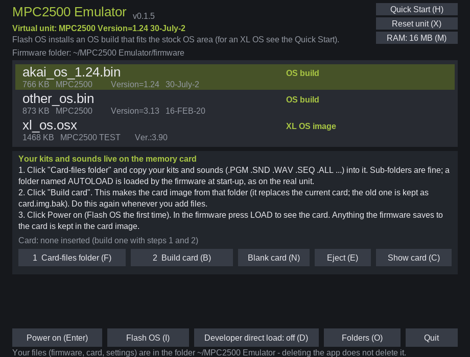
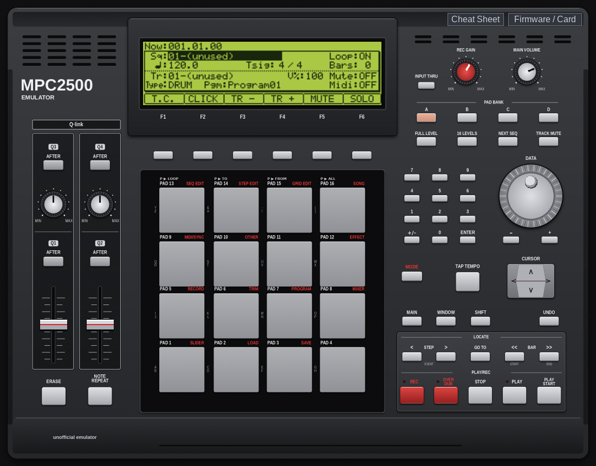
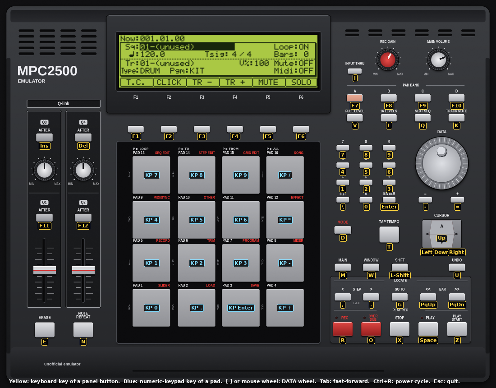
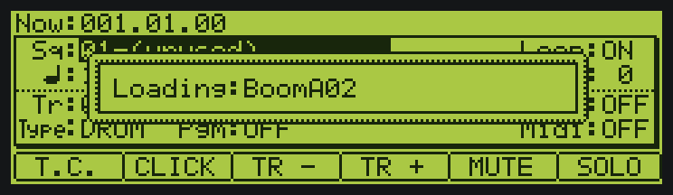
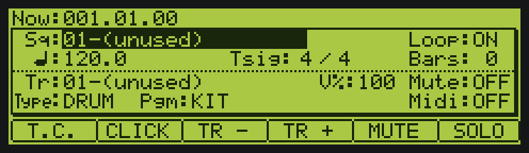
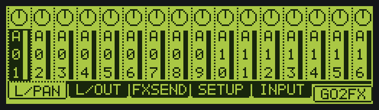
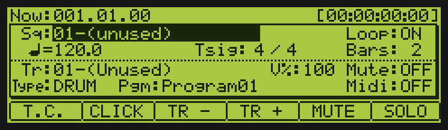
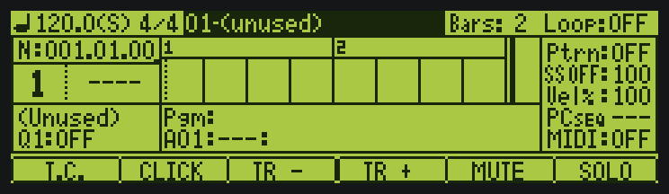

# MPC2500 Emulator — Quick Start Guide

This guide takes you from nothing to a running MPC2500 on your screen, and then shows how to use it to test different kinds of firmware: the stock Akai OS, third-party operating systems, and your own builds.

> **Disclaimer.** This software is provided "as is", without warranty of any kind, and the authors accept no liability for its use (see the full text in [README.md](README.md#mpc2500-emulator)). It is unofficial and not affiliated with Akai Professional. **No firmware is included** — you need your own firmware files and the right to use them. This is an experimental emulator for people who know what they are doing. Testing a firmware here gives **no promise, guarantee or expectation** that it will work on real hardware, and installing it on a real unit **can damage it beyond repair**. The authors do not guarantee the validity of anything the emulator outputs and are not liable for any loss or damage. The full notice appears every time the emulator starts: scroll to the end and click **I accept**, or click **Decline and quit** and it closes.

## Easiest way: the packaged app (no terminal, nothing to install)

Download the file for your system from the project's **Releases** page. It contains everything the emulator needs.

| System | Download | Start it |
|---|---|---|
| Linux (x86_64) | `...-linux-x86_64.tar.gz` | Extract the archive, double-click **MPC2500 Emulator** (choose *Run* if asked) |
| Linux (alternative) | `...-linux-x86_64.AppImage` | Allow executing (right-click > Properties > Permissions), double-click. Needs `libfuse2` on recent Ubuntu; use the tar.gz if it will not start |
| macOS, Apple Silicon (M1 or later) | `...-macOS-arm64.zip` or `.dmg` | Drag **MPC2500 Emulator** to *Applications* |
| macOS, Intel | `...-macOS-x86_64.zip` or `.dmg` | Same |

**macOS, first launch only:** the app is not notarised by Apple, so macOS blocks a normal double-click. Right-click (or Control-click) **MPC2500 Emulator**, choose **Open**, then **Open** again. If macOS still refuses, open *System Settings > Privacy & Security* and choose *Open Anyway* next to the message about the app.

**First start:** the app creates a folder named **MPC2500 Emulator** in your home folder (with `firmware`, `card` and `card-files` inside) and shows the chooser:



1. **Drag your firmware file onto the window** (or copy it into the `firmware` folder and press `R`). The list shows what each file is. Start with the stock Akai OS.
2. Select it and click **Flash OS** (or press `I`, or double-click it). This creates your **virtual unit**, the emulated flash chip that is kept in the file `unit.flash`, installs the OS on it the way the Akai updater does, and powers it on.
3. **Put your kits and sounds on the memory card.** The firmware can only load files from the card, so they have to go on one:
   1. Click **1 Card-files folder** (or press `F`). Your file manager opens the `card-files` folder. Copy your kits and sounds into it (`.PGM`, `.SND`, `.WAV`, `.SEQ`, `.ALL`...). Sub-folders are fine. A folder named `AUTOLOAD` is loaded by the firmware at start-up, as on the real unit.
   2. Click **2 Build card** (or press `B`). This makes the card image from that folder. It replaces the current card (the old one is kept as `card.img.bak`), so do it again whenever you add files.
   3. Click **Power on**. In the firmware press **LOAD** to see the card.

   Other options: **Blank card** makes an *empty* card (nothing on it), **Eject** starts without a card, **Show card** opens the folder holding the card image, and you can drop an existing card image (`.img`) onto the window to use it. Whatever the firmware saves to the card is kept in the card image.

**Installing an XL OS** (one larger than the stock OS area) is different from a normal install, and it overwrites internal memory: read [section 4](#4-installing-an-extra-large-xl-os) first.

**Afterwards:** the chooser appears at every start; press **Enter** (**Power on**) to start the unit as you left it, with its installed OS, settings and internal memory. `Ctrl+O` returns to the chooser from the running emulator, `Esc` quits. The panel controls are described in [section 5](#5-first-run); the other sections of this guide are for people building from source or testing firmware from the command line.

## Memory and card size

- **Memory (RAM):** the emulated unit starts with the **stock 16 MB** of memory, as shipped. To emulate the optional 128 MB expansion (EXM128), click **RAM: 16 MB** in the chooser (or press `M`) to switch it to 128 MB, or pass `--ram 128` on the command line. A kit that is larger than the free sample memory will not load with the stock 16 MB, just as on a real unit.
- **Card size:** the card image is a separate file (a virtual CompactFlash card) and has nothing to do with the unit's memory. The 128 MB that you see is only the default size the emulator gives a new card; **Build card** makes it larger when your files need more. The unit's memory is never stored on the card.

## Where the app keeps your files (and how to uninstall)

The first time the packaged app starts it creates a folder called **MPC2500 Emulator** in your **home folder**: `/Users/<you>/MPC2500 Emulator` on macOS, `/home/<you>/MPC2500 Emulator` on Linux. The chooser also shows this location at the bottom of its window.

| Inside the folder | What it is |
|---|---|
| `firmware/` | the firmware files you added |
| `card-files/` | the kits and sounds you want on the card (you fill this) |
| `card/` | the card image the emulator uses (`card.img`, and `card.img.bak` after a rebuild) |
| `unit.flash` | your **virtual unit**: the emulated flash chip with the installed OS, settings and internal memory (8 MB) |
| `settings.txt` | the app's remembered choices (last firmware, card) |

**Deleting the app does not delete this folder**, and the folder is never removed automatically. To uninstall completely, delete the app *and* the `MPC2500 Emulator` folder. Copy out anything you want to keep first, such as the card image, `unit.flash` (it holds your internal memory) or your own firmware files. To make the app forget your choices without deleting your files, delete only `settings.txt`. Setting the environment variable `MPC2500_HOME` makes the app use a different folder.

---

## Contents
1. [What you need](#1-what-you-need)
2. [Installation](#2-installation)
3. [Getting firmware files](#3-getting-firmware-files)
4. [Installing an Extra Large (XL) OS](#4-installing-an-extra-large-xl-os)
5. [First run](#5-first-run)
6. [CompactFlash cards, kits and AUTOLOAD](#6-compactflash-cards-kits-and-autoload)
7. [Testing your own firmware](#7-testing-your-own-firmware)
8. [Recipes for each firmware type](#8-recipes-for-each-firmware-type)
9. [Everyday tasks](#9-everyday-tasks)
10. [Troubleshooting](#10-troubleshooting)
11. [Updating and removing](#11-updating-and-removing)

---

## 1. What you need

| | |
|---|---|
| Operating system | **Linux** (developed and tested on Ubuntu). macOS may work but is untested; Windows is not supported |
| CPU | Anything that can run roughly 70 million simple operations per second on one core — any desktop from the last ten years |
| Memory / disk | About 300 MB RAM while running; the repository itself is small (a 128 MB card image is created only if you ask for one) |
| Display and sound | A desktop session (X11 or Wayland) and a sound device |
| Tools | `gcc` (or `clang`), `make`, `git`, SDL2 development files, Python 3 with the Pillow imaging library |
| Firmware | At least one MPC2500 firmware file (see [section 3](#3-getting-firmware-files)) |

## 2. Installation

### 2.1 Ubuntu, Debian, Linux Mint

```bash
sudo apt update
sudo apt install -y build-essential git libsdl2-dev python3 python3-pil
```

### 2.2 Other Linux distributions

| Distribution | Command |
|---|---|
| Fedora / RHEL | `sudo dnf install gcc make git SDL2-devel python3 python3-pillow` |
| Arch / Manjaro | `sudo pacman -S base-devel git sdl2 python python-pillow` |
| openSUSE | `sudo zypper install gcc make git SDL2-devel python3 python3-Pillow` |

### 2.3 macOS (untested)

```bash
brew install sdl2 python pillow git
```
The code uses GCC-style extensions that clang accepts, but it has only been built and tested on Linux. If you try it, please report what happens.

### 2.4 Get the code

```bash
git clone <repository-url> mpc2500-emulator
cd mpc2500-emulator
```

### 2.5 Check the tools are in place

```bash
gcc --version          # any recent gcc or clang
make --version
sdl2-config --version  # prints 2.x
python3 -c "import PIL; print('Pillow', PIL.__version__)"
```
If one of these fails, go back to [2.1](#21-ubuntu-debian-linux-mint) / [2.2](#22-other-linux-distributions).

### 2.6 Build

```bash
make -C emu all
```
This produces `emu/mpc2500emu` (the window version). For the headless version used by scripts and tests:

```bash
make -C emu hl         # produces emu/mpc2500emu_hl
```

Optional, about 10 % faster (needs a firmware file in `firmware/` to train on):

```bash
make -C emu pgo FIRMWARE=../firmware/your-firmware.bin     # the path is relative to the emu/ folder
```

### 2.7 Self-test (optional, no firmware needed)

These tests check the emulated CPU and DSP against independent models written from the Renesas manuals:

```bash
python3 tests/cpu_diff.py --states 2     # all 65,536 opcodes; expect "opcodes with a C-vs-reference mismatch: 0"
python3 tests/dsp_diff.py --cases 100000 # expect "... mismatching (header,alu) groups 0"
```

## 3. Getting firmware files

The emulator accepts the same firmware files you would put on a real MPC2500. The stock Akai OS (from Akai's OS update package) is the reference firmware; any other firmware you build or obtain is simply another OS image to test. Put the files in the `firmware/` folder (nothing is shipped; supply your own):

| File | What it is | Where it comes from |
|---|---|---|
| `*.bin` (about 0.8–0.9 MB) | **Full OS build**: boot block + OS | Akai's OS update package, or your own build |
| `*.osx`, `*.os3` (1.2–1.5 MB) | **XL OS images** (larger than the stock OS area); their header reads `MPC2500 TEST ...` | Your own or other XL builds; see [section 4](#4-installing-an-extra-large-xl-os) |
| `*.sos` | **OS only** (no boot block) | Some OS build tools; this is *not* the Akai download (that is the `.bin` above); needs a full build next to it as a donor |
| 8 MiB file | A **whole-flash dump** | A flash backup |

Check what the emulator recognises:

```
$ emu/mpc2500emu --list
firmware folder: firmware
  mpc2500.bin                          784916 bytes  build        MPC2500         Version=1.24   30-July-2
  xl_os.osx                           1503360 bytes  test         MPC2500 TEST       Ver.:3.90
```
(`--firmware-dir DIR` lists another folder.)

## 4. Installing an Extra Large (XL) OS

In this guide an OS image that is **larger than the stock OS area** is called an **Extra Large (XL)** OS, or XL firmware for short.

> [!CAUTION]
> **DANGER: installing an XL OS overwrites part of the internal memory, and it can leave a real unit unusable.**
>
> An XL OS is written over the settings sector and then over the start of the internal memory (see the flash map below). Everything stored in the overwritten area is destroyed. On real hardware this corruption of the internal memory **can happen, and has happened with certain third-party XL firmware in the past**. A corrupted internal memory can make the unit **get stuck in a permanent boot loop**. Installing XL firmware on a real unit is entirely at your own risk, and a unit that no longer starts may not be recoverable.
>
> **If a real unit is stuck in a boot loop.** There is NO guarantee that any of this will work, and this project has not verified it on hardware. Part 1 gets the unit to start again; part 2 tries to repair the internal memory.
>
> **Part 1: get the unit to start again**
>
> 1. **Reinstall the original Akai OS.** Put the original Akai OS file (`MPC2500.BIN`, the file from Akai's OS update download) on a CompactFlash card and install it. If the unit restarts too quickly to use the LOAD page, the boot block's OS UPDATE screen is the route: it opens by itself when there is no valid OS, and the boot code of the emulated unit also opens it when one of the keys OVER DUB, STEP >, WINDOW, TAP TEMPO, 0, 2 or 5 is held while powering on (that combination has not been verified on a real unit; the exact file name the boot-block updater needs on a real unit has not been verified either).
>
> 2. **Create an AUTOLOAD folder.** In the root of the CF card create a folder named `AUTOLOAD` and put a program, kit or sounds inside it.
>
> 3. **Restart the unit with the card inserted.** The Akai OS first looks for its auto load data in the internal memory, then moves on to the card, finds the AUTOLOAD folder, loads it and starts normally (the manual says a card with an AUTOLOAD folder is loaded at power-on whatever the Autoload setting is).
>
> 4. **Turn the Autoload feature off.** In the LOAD page, with the cursor in the "LOAD from" field, press WINDOW. In the Load Setup window set "Autoload" to OFF and press F4 (CLOSE). The unit no longer tries to load anything from the internal memory when it starts.
>
> The unit now starts normally. **But if you try to use the corrupted internal memory from the LOAD or SAVE pages, the unit will probably crash.** Stay away from the INTERNAL MEMORY choices until you have tried part 2.
>
> **Part 2: attempting to repair the internal memory (optional, again no guarantee)**
>
> 5. Put the factory data or your own backup on the card (the CF card that came with the unit has an `INTERNAL` folder with the factory presets and demo sequences). Load it, then save to INTERNAL MEMORY with SAVE ALL PROGRAMS & SAMPLES and SAVE ALL SEQS & SONGS. The manual says this erases the internal flash and replaces its data (at most 5 MB for programs and samples), which is how the factory data is restored. It may rebuild a valid internal memory.
>
> 6. If the unit crashes while doing this, a firmware that clears the internal-memory headers is reported to be needed first (run it once, then install the original Akai OS again and repeat from step 2). No such firmware is included here. If the unit cannot reach the OS UPDATE screen at all, it needs a technician. Once the internal memory works again you can turn Autoload back on in the same Load Setup window.

The unit's 8 MiB flash chip is shared by the boot block, the OS, the settings and the **internal memory**. This is the map the emulator uses (it comes from tracing the real Akai OS and boot block):

| Flash address | Size | What lives there |
|---|---|---|
| `0x000000` - `0x00FFFF` | 64 KiB | Boot block. Never rewritten by any updater |
| `0x010000` - `0x0EFFFF` | 14 sectors of 64 KiB (917,504 bytes) | **The OS area.** The last 16 bytes hold the OS checksum (at `0x0EFFF0`), so an OS can be at most **917,488 bytes** |
| `0x0F0000` - `0x0FFFFF` | 1 sector | The OS's settings |
| `0x100000` and up | to the end of the chip (`0x7FFFFF`) | **Internal memory** (sequences, songs, programs, samples). The stock OS keeps the header of its sequences-and-songs area at `0x100000` (sector 16) and the header of its programs-and-samples area at `0x2A0000` (sector 42) |

**The boot block and the stock Akai OS updater only erase and write the OS area** (`0x010000` - `0x0EFFFF`). They refuse any OS image that does not fit in it (the stock OS answers "File too big: Can't execute!!"). This is how the real unit behaves, and the emulator shows it because the real firmware code is running.

An XL OS **larger than the OS area** can still be installed, but only by an OS that contains its **own installer** and writes beyond the stock limit. It cannot be done by the stock updater. When such an installer runs, the image is laid out contiguously in flash starting at `0x010000`, and **whatever does not fit in the OS area overwrites the flash that follows it**:

1. The first 917,488 bytes of the image fill the OS area.
2. Next it **erases and overwrites the settings sector** (`0x0F0000`). The new OS then writes its own settings there.
3. The rest of the image **erases and overwrites the internal memory, starting at its very first sector (`0x100000`) and continuing upwards, one 64 KiB sector at a time**, for as many sectors as the image needs. That includes the stock OS's sequences-and-songs header.

So an XL OS takes its extra space **out of the internal memory**. Everything stored in the overwritten sectors is destroyed, the start of the internal memory is no longer a valid stock layout, and the unit's own warning says so ("All memory contents will be lost!!"). Sectors beyond the end of the image are not erased by the installer, but with the header at `0x100000` gone they are no longer reachable by the stock OS.

Measured on the emulated unit with real XL firmware (the procedure applies to any XL OS):

| Image | Size | Flash it occupies | Beyond the OS area | Internal-memory sectors overwritten |
|---|---|---|---|---|
| Akai OS 1.24 (stock) | 784,916 B | `0x010000` - `0x0BFA13` | none | none |
| A third-party OS that fits the OS area | 894,040 B | `0x010000` - `0x0DA457` | none (fits) | none |
| XL OS, smallest | 1,175,052 B | `0x010000` - `0x11EE0B` | 192,028 B | sectors 16-17 (`0x100000` - `0x11FFFF`, 128 KiB) |
| XL OS, medium | 1,331,048 B | `0x010000` - `0x144F67` | 348,024 B | sectors 16-20 (`0x100000` - `0x14FFFF`, 320 KiB) |
| XL OS, largest | 1,503,360 B | `0x010000` - `0x16F07F` | 520,336 B | sectors 16-22 (`0x100000` - `0x16FFFF`, 448 KiB) |

For the largest XL OS above the installer was traced in detail: it erased 23 consecutive sectors, `0x010000` - `0x17FFFF` (the OS area, the settings sector and 8 internal-memory sectors), and programmed `0x010000` - `0x16F07F` plus its settings. The table lists the sectors that receive image data; an installer may erase more than it writes.

**The procedure, for any such firmware.** (1) Put an OS with its own installer on the unit (it must fit the OS area, so that the stock updater accepts it). (2) Put the XL image on the card. (3) Install it from that OS's Load page. (4) Power cycle. In the emulator's virtual unit this runs the real installer code: the installer in the test firmware lists an XL file only when it is named with a `.OSX` extension on the card (a file named `.OS3` is not listed), and you press `F6` (DO IT) on the Load page, then `F5` (DO IT) in the update dialog. This sequence is covered by the automated test `tests/install_chain.py` and compared byte for byte with the firmware files.

*How the real unit behaves after such an install, beyond what the firmware itself shows, has not been verified on hardware.*

In the chooser: select an OS that fits and has its own installer, and click **Flash OS**; put the XL image in the **card-files** folder (name it with a `.OSX` extension), click **Build card**, **Power on**, then follow the procedure above. Selecting the XL image in **Flash OS** is refused with an explanation.

**Developer direct load** (button or `D`) skips all of this and loads any image straight into a temporary flash: handy for quick checks, but it is not how the hardware behaves and nothing is kept.

> Installing an XL OS overwrites the start of the virtual unit's internal memory, just as on a real unit (see the table above). To keep a copy, copy `unit.flash` first.

## 5. First run

1. Put one firmware file in `firmware/` (or pass `--firmware path/to/file`).
2. Start the emulator:

```bash
./run_live.sh
```

The first start generates the panel artwork (`skin/`) and builds the emulator if needed. A window opens and the firmware boots in a few seconds.



### Controlling it



- **Buttons:** click them, or use the key shown on the picture above. Clicking holds the button only while the mouse button is down; to use a button combination hold one with the keyboard and click the other (for example hold `D` = `MODE`, then click `PAD 2` to open the Load page).
- **Pads:** click a pad (left button = medium velocity, right = soft, middle = hard) or use the numeric keypad.
- **DATA wheel:** mouse wheel over the window, dragging on the wheel, or `[` and `]`.
- **Q-Links:** drag the Q1/Q2 sliders and Q3/Q4 knobs.
- **Other:** `Tab` (held) fast-forwards, `Ctrl+R` power-cycles, `Esc` quits.

### What you should see
With stock Akai OS 1.24 and no card you land on the main page:


Open the Load page with `MODE` (`D`) + `PAD 2` to see a card (once you have one, section 6):


## 6. CompactFlash cards, kits and AUTOLOAD

The firmware reads and writes a CompactFlash card in the slot. The emulator presents a FAT16 disk image as that card.

### 6.1 Create a card image from files

```bash
python3 tools/mkfat16.py card/card.img 128 KIT.PGM SAMPLE1.SND SAMPLE2.SND
```
This builds a 128 MB image (MBR + FAT16) holding those files in the root folder (`--dir NAME` puts files into a sub-folder). `card/card.img` is inserted automatically on the next start; use `--card other.img` for another one. The emulator works on an in-memory copy, so your image is never modified — add `--save-card FILE` if you want what the firmware saved to the card:

```bash
emu/mpc2500emu --save-card card/after.img
```

### 6.2 Load a kit by hand
`MODE` + `PAD 2` opens the Load page, pick the program or ALL file with the cursor keys and DATA wheel, and press `F6` (DO IT).

### 6.3 Load a kit automatically (AUTOLOAD)
The stock OS loads the contents of a folder named `AUTOLOAD` in the card's root when it starts with the card inserted. You can create it exactly as on the unit: load your kit, then in the Save page (`MODE` + `PAD 3`) choose **SAVE ENTIRE MEMORY**, press `F6`, then `F2` (A.LOAD) and `F5` (DO IT). Or let a script do it:

```bash
tools/make_autoload_card.sh card/in.img card/card.img firmware/your-stock-firmware.bin
```
The next start shows the OS loading the kit by itself:



and ends with the kit selected:



### 6.4 Internal memory
"INTERNAL MEMORY" in the Load and Save pages is the unit's internal flash, not a folder on the card. It lives inside the emulated flash chip and starts empty at every launch. Keep it with `--save-flash FILE` and start from it again with `--flash-state FILE`:

```bash
emu/mpc2500emu --save-flash state.flash          # writes the flash when you quit
emu/mpc2500emu --flash-state state.flash         # starts from that flash instead of the firmware file
```

## 7. Testing your own firmware

Three levels, from quick to thorough. All of them use exactly the same firmware file you would flash.

### 7.1 Interactive
Put the file in `firmware/` (or `--firmware`), run `./run_live.sh`, and use the panel. A crash is reported on the terminal and the window gets a red border; `Ctrl+R` restarts it.

### 7.2 Headless smoke test
Boot without a window for a number of emulated instructions (66,150,000 = one second of unit time) and print the machine state:

```bash
emu/mpc2500emu_hl path/to/firmware.bin --steps 400000000
```

The summary shows the CPU registers, the interrupt and audio setup the firmware programmed, and a categorised **fault summary**. A healthy boot of the stock OS looks like this (shortened):

```
Firmware: mpc2500.bin - OS build
  header: "MPC2500         Version=1.24   30-July-2"
  784916 bytes (79% of the 983024-byte flash OS area); boot checksum 22d01d9f written at 0xEFFF0
...
end: pc=a50185e4 sr=401f1163 steps=200000052
INTC: IPRA=0000 IPRB=0000 IPRC=0000 IPRD=0000 IPRE=8000 IPRF=0008 IPRG=0770  (priority nibbles; 0 = source masked)
      SIOF: SIMDR=0c00 SISCR=c100 SITDAR=8081 ...
fault summary:
  read of unmapped address                 207 events
  write to unmapped address                215 events
```

Fault categories:

| Kind | Stops the run? | Meaning |
|---|---|---|
| illegal instruction, execution at an invalid or odd address, stack pointer outside RAM, write/erase of the flash boot block | **Yes** (fatal) | Something a real unit would crash or brick on |
| read/write of an unmapped address, misaligned access, flash write to the internal-data area | No (counted); `--fault-strict` makes bus faults fatal | Access to hardware the emulator does not model, or a firmware bug |
| hang with interrupts masked, stuck in a loop | No (warning) | Often legitimate (copying data); look at it if the screen is frozen |

The stock OS itself makes a few hundred accesses to devices that are not modelled (they are listed individually in the full output), so **compare your firmware's fault summary with the stock OS's** and look at anything new.

A fatal fault prints a report with the last 64 program counters, the registers and the stack. This one comes from a firmware whose code was overwritten with `0xFFFF` at one place:

```
==== FAULT REPORT: illegal instruction ====
step 7343861, pc=0000041c op=ffff  SR=700000f1 PR=0000086a ...
R0 =00000105 R1 =00000000 R2 =00000000 R3 =ffffff34
...
last pcs (oldest first): 00000856 00000858 ... 00000866 0000041c
stack @R15: 00000000 00000000 ...
```

`pc` is where it stopped, `PR` the return address of the last call, and the last-PCs list shows the path that led there.

### 7.3 Scripted, repeatable tests
The `--exp` mode boots once, then runs one or more **scripts** from that booted state (each in its own process, so they do not disturb each other) and writes LCD frames and audio files:

```bash
emu/mpc2500emu_hl firmware.bin --exp out 300000000 \
   "mainscreen=wait 1000000;dump a" \
   "loadpage=press 0 3;wait 20000000;padhit 2 100;wait 20000000;release 0 3;wait 80000000;dump a"
```
The first number is how many instructions to boot for. Each script is a `name=verb;verb;...` list. The files appear as `out/<name>_<tag>.bin` (the LCD, 240x64 bits) and `.wav`. Turn an LCD dump into a picture with `python3 tools/lcd2png.py out/loadpage_a.bin out/loadpage.png`.

The verbs:

| Verb | Does |
|---|---|
| `wait N` | run N instructions |
| `press c r` / `release c r` / `tap c r` | key-matrix button (column, row; see `panel_map.txt`) |
| `pad n [vel]` / `padup n` / `padhit n [vel]` | pad n (1-16, `PAD 1` bottom-left) down / up / hit |
| `wheel d n` | turn the DATA wheel n detents (`d` ≥ 0 clockwise) |
| `qlink line value` | set a Q-Link input (line 3 = Q1, 0 = Q2, 1 = Q3, 2 = Q4; value 0-1000) |
| `dump tag` | save the LCD frame |
| `audio 1` … `audiosave tag` | capture and save the audio output as WAV |
| `watchw lo len` / `watchr lo len` / `watchoff` | memory write/read watchpoints (physical hex addresses) |
| `bp slot pc`, `ctron` / `ctroff` | breakpoint, first-call trace |
| `reset` | power cycle (flash and card survive) |
| `faults`, `flashstat`, `leds`, `tmu` | print status |

Environment variables select the machine: `CARD=file.img`, `SODIMM_MB=n`, `FAULT_STRICT=1`.

**The project's own regression suite is built this way** and is the best template: `tests/golden.py` boots each firmware, presses keys, hits pads, and compares the LCD and audio against recorded results (`tests/golden.json`). Edit the `IMG` table at the top of `tests/golden.py` to point at your firmware files, then:

```bash
python3 tests/golden.py --bin emu/mpc2500emu_hl --raw -j 4          # run
python3 tests/golden.py --bin emu/mpc2500emu_hl --raw --update      # record new expected results
```
When you change your firmware, a failing scenario tells you which screen or sound changed.

## 8. Recipes for each firmware type

### 8.1 Stock Akai OS (full `.bin` build)
```bash
cp MPC2500.BIN firmware/
./run_live.sh
```
Boots to the main page and behaves as the unit does: loading and saving on the card, sampling engine, Q-Links, the Slider and Mixer pages.



Try the Q-Links: with `MODE` + `PAD 1` open the Slider page, hit the pad you want to assign, set *Change* to REAL TIME and a *Parameter*; then drag Q1.


For CUTOFF and RESO the pad's filter must be switched on in `PROGRAM` → `F2` (FILTER) — with the filter off there is nothing for the Q-Link to offset.


### 8.2 Third-party OS builds that fit the stock OS area (`.bin`)
Same as stock: in the chooser select the file and click **Flash OS**. From source, for a quick developer check:
```bash
./run_live.sh --firmware firmware/custom_os.bin
```


### 8.3 XL firmware (`.osx`, `.os3`)
An XL OS image (larger than the stock OS area) is not accepted by the boot block or the stock updater. In the packaged app it is installed through an OS that has its own installer (see [section 4](#4-installing-an-extra-large-xl-os)). From source, for a quick developer check, the image can be launched directly, skipping the installer:
```bash
./run_live.sh --firmware firmware/xl_os.osx
```


The loader prints a warning such as *"this image overwrites flash sector 15 (settings) and the internal-data sectors"*. That only affects the **emulator's in-memory flash**; every new launch starts clean. It also reminds you that the stock updater cannot install such an image on a real unit.

### 8.4 OS-only `.SOS` files
The Akai OS itself is the `.bin` file (see section 3). An `.SOS` is an OS-only payload that some build tools produce.
These contain only the operating system. Give the emulator a full build with a valid boot block to take it from:

```bash
emu/mpc2500emu --donor firmware/mpc2500.bin firmware/MPC2500.SOS
```
(If a full build is in the same folder as the `.SOS` it is found automatically.)

### 8.5 Whole-flash dumps
An 8 MiB file is treated as the entire flash chip, boot block, OS and internal memory included:
```bash
emu/mpc2500emu --firmware dumps/backup.bin
```
Use `--save-flash` to produce your own dump of the emulated state.

### 8.6 Comparing two firmware versions
Run both through the same script and compare the outputs:
```bash
for f in old.bin new.bin; do
  emu/mpc2500emu_hl $f --exp out_$f 300000000 "main=wait 1000000;dump a;padhit 1 100;wait 20000000;dump b"
done
cmp out_old.bin/main_a.bin out_new.bin/main_a.bin && echo "main page identical"
```

## 9. Everyday tasks

| I want to… | Do this |
|---|---|
| Switch firmware | Quit, then `./run_live.sh --firmware firmware/other-file` |
| Start with a clean machine | Quit and start again, or `Ctrl+R` (keeps flash and card contents, clears RAM) |
| Run faster / skip the boot | Hold `Tab` (8x) |
| Use the 128 MB expansion instead of the stock 16 MB of RAM | `--ram 128` (the default is the stock 16 MB; any size in MB works) |
| Change the output volume | `--audio-shift N` (default 4 = full scale; lower is louder but can clip in WAV captures) |
| Use a different keyboard map | Edit `panel_map.txt`, or `--keymap file` |
| See every option | `emu/mpc2500emu --help` |
| Capture a screenshot of the LCD | Script `dump a`, then `tools/lcd2png.py` |

## 10. Troubleshooting

| Symptom | Cause / fix |
|---|---|
| `sdl2-config: command not found` or SDL errors while building | Install the SDL2 **development** package (`libsdl2-dev` / `SDL2-devel`) |
| `ModuleNotFoundError: No module named 'PIL'` | Install Pillow (`python3-pil` / `python3-pillow`) |
| `no firmware found in 'firmware'` | Put a file in `firmware/` or pass `--firmware FILE` |
| `N firmware files in 'firmware'; choose one with --firmware` | Several files are present; pass `--firmware firmware/NAME` |
| `Cannot load firmware: ...` | The file is not an MPC2500 image the loader recognises; `emu/mpc2500emu --list` shows the detected type |
| Window opens but stays black | The firmware is still booting (give it a few seconds), or the window has a red border: it crashed — read the fault report in the terminal |
| No sound | Check the desktop's sound output; the emulator uses SDL's default device. Nothing plays until a program with a sample is loaded and a pad is hit |
| Sound slightly flat or stuttering | The host is too slow for real time; close other programs or build with `make -C emu pgo` |
| `warning: cannot read card image` | The card image path is wrong; the emulator then runs without a card |
| Keys do nothing | The window must have keyboard focus; key names in `panel_map.txt` follow SDL names (`Left Shift`, `PageUp`, ...) |

## 11. Updating and removing

Update:
```bash
git pull
make -C emu all hl
```
Remove: delete the repository folder. The emulator writes nothing outside it, and it never modifies your firmware files or card images.
