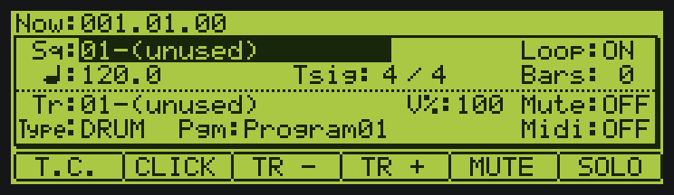
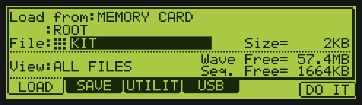
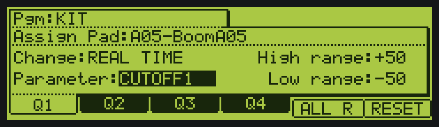
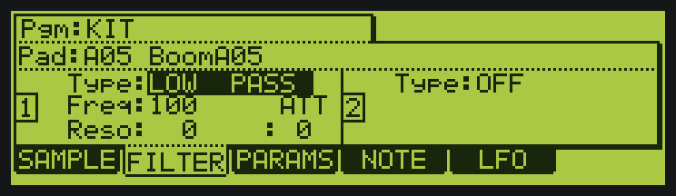

# MPC2500 Emulator — Quick Start Guide

This guide takes you from nothing to a running MPC2500 on your screen, and then shows how to use it to test different kinds of firmware: the stock Akai OS, third-party operating systems, and your own builds.

> **Disclaimer.** This software is provided "as is", without warranty of any kind, and the authors accept no liability for its use (see the full text in [README.md](README.md#mpc2500-emulator)). It is unofficial and not affiliated with Akai Professional. **No firmware is included** — you need your own firmware files and the right to use them. This is an experimental emulator for people who know what they are doing. Testing a firmware here gives **no promise, guarantee or expectation** that it will work on real hardware, and installing it on a real unit **can damage it beyond repair**. The authors do not guarantee the validity of anything the emulator outputs and are not liable for any loss or damage. The full notice appears every time the emulator starts: scroll to the end and click **I accept**, or click **Decline and quit** and it closes.

## Easiest way: the packaged app (no terminal, nothing to install)

Download the file for your system from the project's **Releases** page. It contains everything the emulator needs.

| System | Download | Start it |
|---|---|---|
| Linux (x86_64) | `...-linux-x86_64.tar.gz` | Extract the archive, double-click **MPC2500 Emulator** (choose *Run* if asked) |
| Linux (alternative) | `...-linux-x86_64.AppImage` | Allow executing (right-click > Properties > Permissions), double-click. Needs `libfuse2` on recent Ubuntu; use the tar.gz if it will not start |
| macOS, Apple Silicon (M1 or later) | `...-macOS-arm64.zip` or `.dmg` | Drag **MPC2500 Emulator** to *Applications* |
| macOS, Intel | `...-macOS-x86_64.zip` or `.dmg` | Same |

**macOS, first launch only:** the app is not notarised by Apple, so macOS blocks a normal double-click. Right-click (or Control-click) **MPC2500 Emulator**, choose **Open**, then **Open** again. If macOS still refuses, open *System Settings > Privacy & Security* and choose *Open Anyway* next to the message about the app.

**First start:** the app creates a folder named **MPC2500 Emulator** in your home folder (with `firmware`, `card` and `card-files` inside) and shows the chooser:


1. **Drag your firmware file onto the window** (or copy it into the `firmware` folder and press `R`). The list shows what each file is.
2. Select it and press **Enter** (or double-click it). The emulator window opens and the firmware boots.
3. **Put your kits and sounds on the memory card.** The firmware can only load files from the card, so they have to go on one:
   1. Click **1 Card-files folder** (or press `F`). Your file manager opens the `card-files` folder. Copy your kits and sounds into it (`.PGM`, `.SND`, `.WAV`, `.SEQ`, `.ALL`...). Sub-folders are fine. A folder named `AUTOLOAD` is loaded by the firmware at start-up, as on the real unit.
   2. Click **2 Build card** (or press `B`). This makes the card image from that folder. It replaces the current card (the old one is kept as `card.img.bak`), so do it again whenever you add files.
   3. Click **Start**. In the firmware press **LOAD** to see the card.

   Other options: **Blank card** makes an *empty* card (nothing on it), **Eject** starts without a card, **Show card** opens the folder holding the card image, and you can drop an existing card image (`.img`) onto the window to use it. Whatever the firmware saves to the card is kept in the card image.

**Afterwards:** the chooser appears at every start with your last firmware already selected, so press **Enter** to go. `Ctrl+O` returns to the chooser from the running emulator, `Esc` quits. The panel controls are described in [section 4](#4-first-run); the other sections of this guide are for people building from source or testing firmware from the command line.


## Where the app keeps your files (and how to uninstall)

The first time the packaged app starts it creates a folder called **MPC2500 Emulator** in your **home folder**: `/Users/<you>/MPC2500 Emulator` on macOS, `/home/<you>/MPC2500 Emulator` on Linux. The chooser also shows this location at the bottom of its window.

| Inside the folder | What it is |
|---|---|
| `firmware/` | the firmware files you added |
| `card-files/` | the kits and sounds you want on the card (you fill this) |
| `card/` | the card image the emulator uses (`card.img`, and `card.img.bak` after a rebuild) |
| `settings.txt` | the app's remembered choices (last firmware, card) |

**Deleting the app does not delete this folder**, and the folder is never removed automatically. To uninstall completely, delete the app *and* the `MPC2500 Emulator` folder. Copy out anything you want to keep first, such as the card image or your own firmware files. To make the app forget your choices without deleting your files, delete only `settings.txt`. Setting the environment variable `MPC2500_HOME` makes the app use a different folder.

---

## Contents
1. [What you need](#1-what-you-need)
2. [Installation](#2-installation)
3. [Getting firmware files](#3-getting-firmware-files)
4. [First run](#4-first-run)
5. [CompactFlash cards, kits and AUTOLOAD](#5-compactflash-cards-kits-and-autoload)
6. [Testing your own firmware](#6-testing-your-own-firmware)
7. [Recipes for each firmware type](#7-recipes-for-each-firmware-type)
8. [Everyday tasks](#8-everyday-tasks)
9. [Troubleshooting](#9-troubleshooting)
10. [Updating and removing](#10-updating-and-removing)

---

## 1. What you need

| | |
|---|---|
| Operating system | **Linux** (developed and tested on Ubuntu). macOS may work but is untested; Windows is not supported |
| CPU | Anything that can run roughly 70 million simple operations per second on one core — any desktop from the last ten years |
| Memory / disk | About 300 MB RAM while running; the repository itself is small (a 128 MB card image is created only if you ask for one) |
| Display and sound | A desktop session (X11 or Wayland) and a sound device |
| Tools | `gcc` (or `clang`), `make`, `git`, SDL2 development files, Python 3 with the Pillow imaging library |
| Firmware | At least one MPC2500 firmware file (see [section 3](#3-getting-firmware-files)) |

## 2. Installation

### 2.1 Ubuntu, Debian, Linux Mint

```bash
sudo apt update
sudo apt install -y build-essential git libsdl2-dev python3 python3-pil
```

### 2.2 Other Linux distributions

| Distribution | Command |
|---|---|
| Fedora / RHEL | `sudo dnf install gcc make git SDL2-devel python3 python3-pillow` |
| Arch / Manjaro | `sudo pacman -S base-devel git sdl2 python python-pillow` |
| openSUSE | `sudo zypper install gcc make git SDL2-devel python3 python3-Pillow` |

### 2.3 macOS (untested)

```bash
brew install sdl2 python pillow git
```
The code uses GCC-style extensions that clang accepts, but it has only been built and tested on Linux. If you try it, please report what happens.

### 2.4 Get the code

```bash
git clone <repository-url> mpc2500-emulator
cd mpc2500-emulator
```

### 2.5 Check the tools are in place

```bash
gcc --version          # any recent gcc or clang
make --version
sdl2-config --version  # prints 2.x
python3 -c "import PIL; print('Pillow', PIL.__version__)"
```
If one of these fails, go back to [2.1](#21-ubuntu-debian-linux-mint) / [2.2](#22-other-linux-distributions).

### 2.6 Build

```bash
make -C emu all
```
This produces `emu/mpc2500emu` (the window version). For the headless version used by scripts and tests:

```bash
make -C emu hl         # produces emu/mpc2500emu_hl
```

Optional, about 10 % faster (needs a firmware file in `firmware/` to train on):

```bash
make -C emu pgo FIRMWARE=../firmware/your-firmware.bin     # the path is relative to the emu/ folder
```

### 2.7 Self-test (optional, no firmware needed)

These tests check the emulated CPU and DSP against independent models written from the Renesas manuals:

```bash
python3 tests/cpu_diff.py --states 2     # all 65,536 opcodes; expect "opcodes with a C-vs-reference mismatch: 0"
python3 tests/dsp_diff.py --cases 100000 # expect "... mismatching (header,alu) groups 0"
```

## 3. Getting firmware files

The emulator accepts the same files you would put on a real MPC2500. Put them in the `firmware/` folder (nothing is shipped; supply your own):

| File | What it is | Where it comes from |
|---|---|---|
| `*.bin` (about 0.8–0.9 MB) | **Full OS build** — boot block + OS, as in the OS update package | Akai's OS update, or a JJOS release |
| `*.osx`, `*.os3` (1.2–1.5 MB) | **Run-in-place test images** whose header reads `MPC2500 TEST ...` | JJOS XL / Light / OS3 distributions |
| `*.sos` | **OS only** (no boot block) | OS update packages; needs a full build next to it as a donor |
| 8 MiB file | A **whole-flash dump** | A flash backup |

Check what the emulator recognises:

```
$ emu/mpc2500emu --list
firmware folder: firmware
  mpc2500.bin                          784916 bytes  build        MPC2500         Version=1.24   30-July-2
  mpc2500_xl390.osx                   1503360 bytes  test         MPC2500 TEST       Ver.:3.90
```
(`--firmware-dir DIR` lists another folder.)

## 4. First run

1. Put one firmware file in `firmware/` (or pass `--firmware path/to/file`).
2. Start the emulator:

```bash
./run_live.sh
```

The first start generates the panel artwork (`skin/`) and builds the emulator if needed. A window opens and the firmware boots in a few seconds.


### Controlling it


- **Buttons:** click them, or use the key shown on the picture above. Clicking holds the button only while the mouse button is down; to use a button combination hold one with the keyboard and click the other (for example hold `D` = `MODE`, then click `PAD 2` to open the Load page).
- **Pads:** click a pad (left button = medium velocity, right = soft, middle = hard) or use the numeric keypad.
- **DATA wheel:** mouse wheel over the window, dragging on the wheel, or `[` and `]`.
- **Q-Links:** drag the Q1/Q2 sliders and Q3/Q4 knobs.
- **Other:** `Tab` (held) fast-forwards, `Ctrl+R` power-cycles, `Esc` quits.

### What you should see
With stock Akai OS 1.24 and no card you land on the main page:



Open the Load page with `MODE` (`D`) + `PAD 2` to see a card (once you have one, section 5):



## 5. CompactFlash cards, kits and AUTOLOAD

The firmware reads and writes a CompactFlash card in the slot. The emulator presents a FAT16 disk image as that card.

### 5.1 Create a card image from files

```bash
python3 tools/mkfat16.py card/card.img 128 KIT.PGM SAMPLE1.SND SAMPLE2.SND
```
This builds a 128 MB image (MBR + FAT16) holding those files in the root folder (`--dir NAME` puts files into a sub-folder). `card/card.img` is inserted automatically on the next start; use `--card other.img` for another one. The emulator works on an in-memory copy, so your image is never modified — add `--save-card FILE` if you want what the firmware saved to the card:

```bash
emu/mpc2500emu --save-card card/after.img
```

### 5.2 Load a kit by hand
`MODE` + `PAD 2` opens the Load page, pick the program or ALL file with the cursor keys and DATA wheel, and press `F6` (DO IT).

### 5.3 Load a kit automatically (AUTOLOAD)
The stock OS loads the contents of a folder named `AUTOLOAD` in the card's root when it starts with the card inserted. You can create it exactly as on the unit: load your kit, then in the Save page (`MODE` + `PAD 3`) choose **SAVE ENTIRE MEMORY**, press `F6`, then `F2` (A.LOAD) and `F5` (DO IT). Or let a script do it:

```bash
tools/make_autoload_card.sh card/in.img card/card.img firmware/your-stock-firmware.bin
```
The next start shows the OS loading the kit by itself:


and ends with the kit selected:


### 5.4 Internal memory
"INTERNAL MEMORY" in the Load and Save pages is the unit's internal flash, not a folder on the card. It lives inside the emulated flash chip and starts empty at every launch. Keep it with `--save-flash FILE` and start from it again with `--flash-state FILE`:

```bash
emu/mpc2500emu --save-flash state.flash          # writes the flash when you quit
emu/mpc2500emu --flash-state state.flash         # starts from that flash instead of the firmware file
```

## 6. Testing your own firmware

Three levels, from quick to thorough. All of them use exactly the same firmware file you would flash.

### 6.1 Interactive
Put the file in `firmware/` (or `--firmware`), run `./run_live.sh`, and use the panel. A crash is reported on the terminal and the window gets a red border; `Ctrl+R` restarts it.

### 6.2 Headless smoke test
Boot without a window for a number of emulated instructions (66,150,000 = one second of unit time) and print the machine state:

```bash
emu/mpc2500emu_hl path/to/firmware.bin --steps 400000000
```

The summary shows the CPU registers, the interrupt and audio setup the firmware programmed, and a categorised **fault summary**. A healthy boot of the stock OS looks like this (shortened):

```
Firmware: mpc2500.bin - OS build
  header: "MPC2500         Version=1.24   30-July-2"
  784916 bytes (79% of the 983024-byte flash OS area); boot checksum 22d01d9f written at 0xEFFF0
...
end: pc=a50185e4 sr=401f1163 steps=200000052
INTC: IPRA=0000 IPRB=0000 IPRC=0000 IPRD=0000 IPRE=8000 IPRF=0008 IPRG=0770  (priority nibbles; 0 = source masked)
      SIOF: SIMDR=0c00 SISCR=c100 SITDAR=8081 ...
fault summary:
  read of unmapped address                 207 events
  write to unmapped address                215 events
```

Fault categories:

| Kind | Stops the run? | Meaning |
|---|---|---|
| illegal instruction, execution at an invalid or odd address, stack pointer outside RAM, write/erase of the flash boot block | **Yes** (fatal) | Something a real unit would crash or brick on |
| read/write of an unmapped address, misaligned access, flash write to the internal-data area | No (counted); `--fault-strict` makes bus faults fatal | Access to hardware the emulator does not model, or a firmware bug |
| hang with interrupts masked, stuck in a loop | No (warning) | Often legitimate (copying data); look at it if the screen is frozen |

The stock OS itself makes a few hundred accesses to devices that are not modelled (they are listed individually in the full output), so **compare your firmware's fault summary with the stock OS's** and look at anything new.

A fatal fault prints a report with the last 64 program counters, the registers and the stack. This one comes from a firmware whose code was overwritten with `0xFFFF` at one place:

```
==== FAULT REPORT: illegal instruction ====
step 7343861, pc=0000041c op=ffff  SR=700000f1 PR=0000086a ...
R0 =00000105 R1 =00000000 R2 =00000000 R3 =ffffff34
...
last pcs (oldest first): 00000856 00000858 ... 00000866 0000041c
stack @R15: 00000000 00000000 ...
```

`pc` is where it stopped, `PR` the return address of the last call, and the last-PCs list shows the path that led there.

### 6.3 Scripted, repeatable tests
The `--exp` mode boots once, then runs one or more **scripts** from that booted state (each in its own process, so they do not disturb each other) and writes LCD frames and audio files:

```bash
emu/mpc2500emu_hl firmware.bin --exp out 300000000 \
   "mainscreen=wait 1000000;dump a" \
   "loadpage=press 0 3;wait 20000000;padhit 2 100;wait 20000000;release 0 3;wait 80000000;dump a"
```
The first number is how many instructions to boot for. Each script is a `name=verb;verb;...` list. The files appear as `out/<name>_<tag>.bin` (the LCD, 240x64 bits) and `.wav`. Turn an LCD dump into a picture with `python3 tools/lcd2png.py out/loadpage_a.bin out/loadpage.png`.

The verbs:

| Verb | Does |
|---|---|
| `wait N` | run N instructions |
| `press c r` / `release c r` / `tap c r` | key-matrix button (column, row; see `panel_map.txt`) |
| `pad n [vel]` / `padup n` / `padhit n [vel]` | pad n (1-16, `PAD 1` bottom-left) down / up / hit |
| `wheel d n` | turn the DATA wheel n detents (`d` ≥ 0 clockwise) |
| `qlink line value` | set a Q-Link input (line 3 = Q1, 0 = Q2, 1 = Q3, 2 = Q4; value 0-1000) |
| `dump tag` | save the LCD frame |
| `audio 1` … `audiosave tag` | capture and save the audio output as WAV |
| `watchw lo len` / `watchr lo len` / `watchoff` | memory write/read watchpoints (physical hex addresses) |
| `bp slot pc`, `ctron` / `ctroff` | breakpoint, first-call trace |
| `reset` | power cycle (flash and card survive) |
| `faults`, `flashstat`, `leds`, `tmu` | print status |

Environment variables select the machine: `CARD=file.img`, `SODIMM_MB=n`, `FAULT_STRICT=1`.

**The project's own regression suite is built this way** and is the best template: `tests/golden.py` boots each firmware, presses keys, hits pads, and compares the LCD and audio against recorded results (`tests/golden.json`). Edit the `IMG` table at the top of `tests/golden.py` to point at your firmware files, then:

```bash
python3 tests/golden.py --bin emu/mpc2500emu_hl --raw -j 4          # run
python3 tests/golden.py --bin emu/mpc2500emu_hl --raw --update      # record new expected results
```
When you change your firmware, a failing scenario tells you which screen or sound changed.

## 7. Recipes for each firmware type

### 7.1 Stock Akai OS (full `.bin` build)
```bash
cp MPC2500.BIN firmware/
./run_live.sh
```
Boots to the main page and behaves as the unit does: loading and saving on the card, sampling engine, Q-Links, the Slider and Mixer pages.


Try the Q-Links: with `MODE` + `PAD 1` open the Slider page, hit the pad you want to assign, set *Change* to REAL TIME and a *Parameter*; then drag Q1.



For CUTOFF and RESO the pad's filter must be switched on in `PROGRAM` → `F2` (FILTER) — with the filter off there is nothing for the Q-Link to offset.



### 7.2 JJOS full builds (`.bin`)
Same as stock:
```bash
./run_live.sh --firmware firmware/mpc2500_jv313.bin
```


### 7.3 Run-in-place test images (`.osx`, `.os3`)
These are launched directly by the boot block without the normal update step:
```bash
./run_live.sh --firmware firmware/mpc2500_xl390.osx
```


The loader prints a warning such as *"this image overwrites flash sector 15 (settings) and the internal-data sectors"*. That only affects the **emulator's in-memory flash**; every new launch starts clean. It also reminds you that the stock updater cannot install such an image on a real unit.

The Light and OS3 images open with a welcome dialog; press `F6` (OK) to continue:


### 7.4 OS-only `.SOS` files
These contain only the operating system. Give the emulator a full build with a valid boot block to take it from:

```bash
emu/mpc2500emu --donor firmware/mpc2500.bin firmware/MPC2500.SOS
```
(If a full build is in the same folder as the `.SOS` it is found automatically.)

### 7.5 Whole-flash dumps
An 8 MiB file is treated as the entire flash chip, boot block, OS and internal memory included:
```bash
emu/mpc2500emu --firmware dumps/backup.bin
```
Use `--save-flash` to produce your own dump of the emulated state.

### 7.6 Comparing two firmware versions
Run both through the same script and compare the outputs:
```bash
for f in old.bin new.bin; do
  emu/mpc2500emu_hl $f --exp out_$f 300000000 "main=wait 1000000;dump a;padhit 1 100;wait 20000000;dump b"
done
cmp out_old.bin/main_a.bin out_new.bin/main_a.bin && echo "main page identical"
```

## 8. Everyday tasks

| I want to… | Do this |
|---|---|
| Switch firmware | Quit, then `./run_live.sh --firmware firmware/other-file` |
| Start with a clean machine | Quit and start again, or `Ctrl+R` (keeps flash and card contents, clears RAM) |
| Run faster / skip the boot | Hold `Tab` (8x) |
| Use the stock 16 MB of RAM | `--ram 0` (default is a 128 MB SODIMM; any size in MB works) |
| Change the output volume | `--audio-shift N` (default 4 = full scale; lower is louder but can clip in WAV captures) |
| Use a different keyboard map | Edit `panel_map.txt`, or `--keymap file` |
| See every option | `emu/mpc2500emu --help` |
| Capture a screenshot of the LCD | Script `dump a`, then `tools/lcd2png.py` |

## 9. Troubleshooting

| Symptom | Cause / fix |
|---|---|
| `sdl2-config: command not found` or SDL errors while building | Install the SDL2 **development** package (`libsdl2-dev` / `SDL2-devel`) |
| `ModuleNotFoundError: No module named 'PIL'` | Install Pillow (`python3-pil` / `python3-pillow`) |
| `no firmware found in 'firmware'` | Put a file in `firmware/` or pass `--firmware FILE` |
| `N firmware files in 'firmware'; choose one with --firmware` | Several files are present; pass `--firmware firmware/NAME` |
| `Cannot load firmware: ...` | The file is not an MPC2500 image the loader recognises; `emu/mpc2500emu --list` shows the detected type |
| Window opens but stays black | The firmware is still booting (give it a few seconds), or the window has a red border: it crashed — read the fault report in the terminal |
| No sound | Check the desktop's sound output; the emulator uses SDL's default device. Nothing plays until a program with a sample is loaded and a pad is hit |
| Sound slightly flat or stuttering | The host is too slow for real time; close other programs or build with `make -C emu pgo` |
| `warning: cannot read card image` | The card image path is wrong; the emulator then runs without a card |
| Keys do nothing | The window must have keyboard focus; key names in `panel_map.txt` follow SDL names (`Left Shift`, `PageUp`, ...) |

## 10. Updating and removing

Update:
```bash
git pull
make -C emu all hl
```
Remove: delete the repository folder. The emulator writes nothing outside it, and it never modifies your firmware files or card images.
