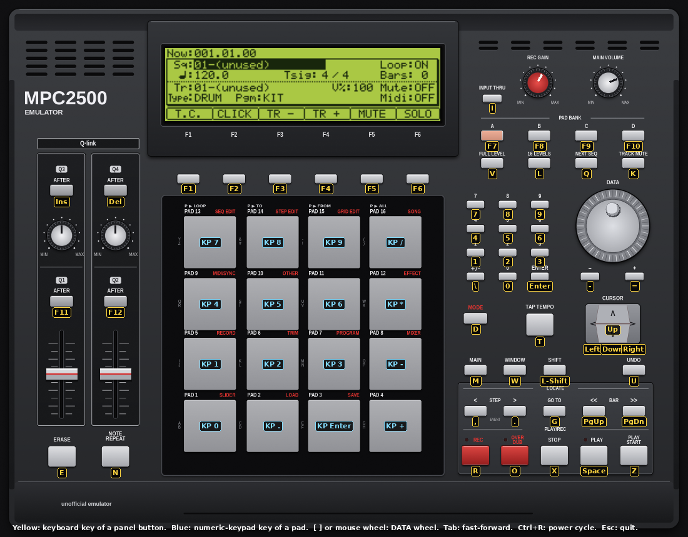
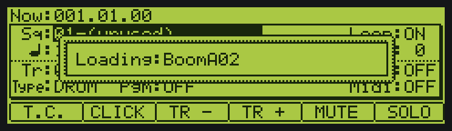

# MPC2500 Emulator

A from-scratch software emulator of the **Akai MPC2500** (Hitachi/Renesas SH7727 "SH3-DSP" based sampler/sequencer), built to **run and test MPC2500 firmware on a computer** with the front panel, LCD, pads, wheel, Q-Links and audio output behaving as they do on the unit.

It runs the stock Akai OS and third-party operating systems (JJOS family) unmodified, from the same firmware files you would put on a real MPC2500, so you can try a new or modified firmware build before it goes anywhere near hardware.

<p align="center">
  
</p>

> **Disclaimer — please read.** This software is provided **"as is", without warranty of any kind**, express or implied, including but not limited to the warranties of merchantability, fitness for a particular purpose and non-infringement. The authors accept **no liability** for any claim, damages or other liability arising from the use of, or inability to use, this software. It is an independent, unofficial project: it is **not affiliated with, endorsed by or supported by Akai Professional, inMusic, Renesas, JJOS authors or any other firmware author**. "Akai", "Akai Professional", "MPC" and "MPC2500" are trademarks of their respective owners and are used here only to identify the hardware being emulated; the application carries no manufacturer logos. **No Akai or third-party firmware, manuals or other copyrighted material is included**; you must supply your own firmware files and are responsible for having the right to use them.
>
> **EXPERIMENTAL SOFTWARE — ONLY FOR PEOPLE WHO KNOW EXACTLY WHAT THEY ARE DOING.** The emulator shows the full notice below **every time it starts**; you must read it to the end and click **I accept**. If you decline (or close the window) the application exits immediately.
>
> 1. **Experimental.** This is an unfinished research tool for people who understand embedded firmware, flash memory and the risks of modifying hardware. If you do not, do not use it and do not install any firmware on a real unit.
> 2. **Testing here proves nothing about real hardware.** If you create, modify, patch, port or obtain a firmware and run it in this emulator, that gives **no promise, guarantee or expectation of any kind** that it will work on a real MPC2500 — or that it is safe. The emulator does not model every device, register, timing, power or fault condition, and what it does model may be wrong in ways that are known and in ways that are not.
> 3. **Installing firmware can permanently damage your hardware.** It can leave a unit unable to start or recover ("bricked"), erase internal memory and data, void the warranty, or damage it **beyond repair**. Nothing in this project — documentation, examples, messages, test results, screenshots or emulator output — is a recommendation or approval to install anything on real hardware. You do so entirely at your own risk.
> 4. **No guarantee that the emulator's output is valid.** No representation is made about the validity, accuracy, completeness, timing, fidelity or reliability of anything it produces or reports (audio, display, timing, files and disk images, logs, fault reports, test results). Do not rely on it for decisions about hardware, firmware or data. No error here does not mean there is no error.
> 5. **No warranty.** Provided "as is" and "as available", without warranty of any kind, express, implied or statutory, including merchantability, fitness for a particular purpose, accuracy, non-infringement and quiet enjoyment.
> 6. **No liability.** To the fullest extent permitted by law the authors and contributors are not liable for any claim, loss or damage — direct, indirect, incidental, special, consequential or punitive, including damage to or destruction of hardware and loss of data — arising from the use of, or inability to use, this software or its output, whether in contract, tort (including negligence) or otherwise, even if advised of the possibility.
> 7. **You assume all risk** for the firmware you run, create, modify or install, for backups, for having the right to use any material you load, and for complying with applicable law and licences. You agree to indemnify and hold harmless the authors and contributors from claims arising from your use.
> 8. **Not affiliated** with Akai Professional, inMusic, Renesas or any firmware author; trademarks are used only to identify the emulated hardware. No firmware is supplied.

---

## Contents
- [What it is](#what-it-is)
- [Features](#features)
- [Screenshots](#screenshots)
- [What is emulated, and what is not](#what-is-emulated-and-what-is-not)
- [Firmware compatibility](#firmware-compatibility)
- [The virtual unit](#the-virtual-unit-installing-firmware-like-the-real-hardware)
- [Download and run](#download-and-run-no-terminal-nothing-to-install)
- [Quick start (from source)](#quick-start-from-source)
- [Using the front panel](#using-the-front-panel)
- [CompactFlash cards, AUTOLOAD and internal memory](#compactflash-cards-autoload-and-internal-memory)
- [Testing your own firmware](#testing-your-own-firmware)
- [Accuracy and verification](#accuracy-and-verification)
- [Performance](#performance)
- [Repository layout](#repository-layout)
- [Known limitations](#known-limitations)
- [Documentation](#documentation)
- [Licence and legal](#licence-and-legal) (MIT)

## What it is
The MPC2500 firmware expects a specific machine: an SH7727 CPU with its DSP unit, 16 MB (or more, with a SODIMM) of SDRAM, an 8 MB flash chip holding the boot block, the operating system and the internal memory, a CompactFlash slot, a 240x64 T6963C LCD, a key matrix, sixteen velocity pads read through an analogue multiplexer and the SH7727's ADC, a quadrature DATA wheel, four Q-Link controls, and an audio path fed through the on-chip SIOF.

This project models that machine, written from public documentation (the SH-3/SH3-DSP software manual, the SH7727 hardware manual, the MPC2500 operator's and service manuals) and from observing what the firmware itself does. It contains **no code from other emulators and no Akai code**.

## Features
- **Complete SH7727 CPU core**: the full SH-3 integer instruction set plus the SH3-DSP unit (parallel ALU/multiply/transfer instructions, X/Y memory, modulo addressing, hardware repeat loops). The integer core was checked against an independent model over all 65,536 opcodes; the DSP unit was checked against a second independent model over hundreds of thousands of random instructions (see [Accuracy and verification](#accuracy-and-verification)).
- **Runs unmodified firmware**: stock Akai OS and the JJOS builds, from their original files (`.bin`, `.osx`, `.os3`, OS-only `.SOS` with a boot-block donor, or an 8 MB flash dump).
- **A virtual unit that installs firmware like the real one**: the flash chip is kept in a file, the stock OS and JJOS install updates through their own Load-page updaters, and the large JJOS XL/OS3/Light images need JV 3.13 first, exactly as on the hardware. A developer direct-load mode is available for quick tests.
- **Real front panel**: every button, 16 velocity-sensitive pads (mouse buttons choose the velocity), a DATA wheel (mouse wheel, drag or `[` `]`), four Q-Link controls that the firmware reads through the real ADC path, LEDs driven the way the firmware drives them, and a keyboard map for the whole panel.
- **Audio**: the firmware's own 32-voice sample engine runs on the emulated DSP; its SIOF output is decoded to stereo and played through your sound card. Panning, filters, tuning, polyphony and stereo samples work.
- **Storage**: a CompactFlash card image in FAT16 (including `AUTOLOAD`), a 128 MB SODIMM option (or the stock 16 MB), and an 8 MB AM29LV641DL-style flash with real command sequences, so firmware that writes flash behaves realistically.
- **Firmware-developer tooling**: fault reports (illegal instruction, wild jumps, unmapped accesses, boot-block writes), a headless mode, a scripting interface for repeatable tests, memory watchpoints, breakpoints, whole-flash save/restore and a regression suite.
- **Packaged apps** for Linux and macOS with everything built in: a chooser window, drag-and-drop for firmware and card images, and card changes kept between sessions.
- Built from source on Linux with SDL2 as the only dependency.

## Screenshots

The keyboard map, drawn on the panel (every yellow tag is the key for that button, blue tags are the numeric-keypad keys for the pads):



Real output of the emulated firmware (the LCD is the emulated T6963C frame buffer):

| | |
|---|---|
|  <br> The stock OS loading the kit from the card's `AUTOLOAD` folder at power-up |  <br> The main page afterwards, with `Pgm:KIT` loaded |
|  <br> `MODE` + `PAD 2` — the Load page listing the card |  <br> The Mixer (L/PAN) page; Q1/Q2 move the level and pan of the selected pad |
|  <br> The Q-Link Slider page (`MODE` + `PAD 1`), here REAL TIME / CUTOFF1 |  <br> Program FILTER page; the Q-Link cutoff/resonance offsets act on an enabled filter |

## What is emulated, and what is not

| Area | Status |
|---|---|
| SH7727 CPU (SH-3 core, SH3-DSP unit, X/Y memory, repeat loops) | Emulated; verified against independent models |
| Interrupts: TMU timers, DMAC channel 0, SIOF, ADC, IRQ levels/priorities, INTEVT codes | Emulated |
| SDRAM 16 MB and SODIMM (SPD detection over the emulated I2C bus) | Emulated |
| 8 MB flash (AMD command set: program, sector/chip erase, unlock bypass, autoselect, CFI) | Emulated; boot-block writes are reported as faults |
| CompactFlash card (True-IDE: IDENTIFY, LBA and CHS reads/writes, FAT16 images) | Emulated |
| 240x64 T6963C LCD | Emulated (full command set; stand-in 8x8 character generator) |
| Key matrix (5 columns x 11 rows), LEDs | Emulated; LED data decoded from the firmware's port writes |
| Pads (16, velocity from mouse button) | Emulated through the ADC multiplexer |
| DATA wheel | Emulated as a quadrature encoder |
| Q-Link Q1-Q4 | Emulated through the ADC (Q1/Q2 verified in the Mixer page; Q3/Q4 assigned by scan order) |
| Audio output (stereo, 44.1 kHz) | Emulated |
| MIDI in/out | **Not emulated** (the UART reports idle) |
| USB device/host | **Not emulated** (the OS enables the interrupts; they never fire) |
| Audio inputs, digital in/out, REC GAIN / MAIN VOLUME knobs | **Not emulated** (the knobs are drawn but not connected) |
| Hard-disk and CD-drive options | **Not emulated** |
| Real-time clock, watchdog, power sequencing | **Not emulated** |

## Firmware compatibility

The files below boot to their user interface in the emulator. Only the firmware you supply is used; none is distributed here.

| Firmware | File type | Result |
|---|---|---|
| Akai OS 1.24 (stock) | full build (`.bin`) | Boots, runs, loads/saves to the card, plays samples, Q-Links work |
| JJOS "JV" 3.13 | full build (`.bin`) | Boots to its own main page (time-code display) |
| JJOS XL 3.90 | run-in-place test image (`.osx`) | Installs from JV 3.13's Load page in the virtual unit, then boots to the XL main page; Q-Links work with its filters |
| JJOS Light 1.00 | run-in-place test image (`.osx`) | Boots to its welcome dialog |
| JJOS 3 (OS3) 2.63 | run-in-place test image (`.os3`) | Boots to its welcome dialog |

<p>
  
  
  
</p>

"Boots" means the regression suite reaches and checks the screen shown; it does not mean every feature of every firmware has been exercised. Please report differences you find against real hardware.

## Download and run (no terminal, nothing to install)

Ready-to-run applications for Linux and macOS are attached to each release on the project's **Releases** page. Everything they need is inside; there is nothing else to install.

| System | File | How to start |
|---|---|---|
| **Linux** (x86_64) | `MPC2500-Emulator-<version>-linux-x86_64.tar.gz` | Extract it, then double-click **MPC2500 Emulator** (if your file manager asks, choose *Run*) |
| Linux (alternative) | `MPC2500-Emulator-<version>-linux-x86_64.AppImage` | Right-click > Properties > allow executing, then double-click (needs FUSE 2: `libfuse2` on Ubuntu 22.04+) |
| **macOS, Apple Silicon** (M1 and later) | `MPC2500-Emulator-<version>-macOS-arm64.zip` (or `.dmg`) | Open it, drag **MPC2500 Emulator** to *Applications*, then right-click > *Open* the first time |
| **macOS, Intel** | `MPC2500-Emulator-<version>-macOS-x86_64.zip` (or `.dmg`) | Same as above |

On the first start the app creates a folder called **MPC2500 Emulator** in your home folder and shows a chooser. **Drag your firmware file onto the window** (start with the stock Akai OS), pick it in the list and click **Flash OS**: that creates your virtual unit and starts it. The chooser also lets you add a CompactFlash card image (drop a `.img` file), create a blank card, or build a card from a folder of files, all with the mouse:

<p align="center"></p>

Next time the chooser appears again: press Enter (**Power on**) to start the unit as you left it. To get kits and sounds into the emulator, use the card panel in the chooser (**1 Card-files folder**, copy your files in, **2 Build card**, then Power on). While it runs: drop another firmware or card file on the window to switch, `Ctrl+O` returns to the chooser, and what the firmware saves to the card is kept. macOS shows a one-time security prompt because the app is not notarised by Apple (see [packaging/README.md](packaging/README.md#notes)). To build the applications yourself see [packaging/README.md](packaging/README.md).


## The virtual unit: installing firmware like the real hardware

The packaged app behaves like a real MPC2500, including the way firmware gets onto it. The emulator keeps the contents of the unit's flash chip (boot block, installed OS, settings and the **internal memory**) in a file, `unit.flash`, in your **MPC2500 Emulator** folder. Whatever is installed stays installed between runs.

<p align="center"></p>

| Chooser button | What it does |
|---|---|
| **Power on** (Enter) | Starts the unit with whatever OS is installed in it |
| **Flash OS** (I) | Writes the selected OS build to the unit like the Akai updater: only the OS area is rewritten; settings and internal memory stay. Use it to create the unit the first time (pick the stock Akai OS) |
| **Developer direct load** (D) | Developer shortcut: loads any image straight into a temporary flash and **skips the installer**. This is *not* how the hardware works; nothing is kept |
| **Reset unit** (X) | Erases the unit (OS, settings, internal memory) |

The real rules are enforced by the firmware itself, which runs unmodified:

- The boot block and the stock Akai OS only accept OS builds that fit the OS area, and refuse the large **JJOS XL / OS3 / Light** images ("File too big"). The chooser tells you the same and does not flash them.
- To get a JJOS XL, OS3 or Light, first install **JJOS JV 3.13**: **Flash OS** it, or copy it to the card as `MPC2500.BIN` and install it from the stock OS's **Load** page. Then put the XL, OS3 or Light file on the card with a `.OSX` name and install it from **JV 3.13's Load page** ("OS-XL update"), exactly as on the unit. Power the unit off and on and it starts the new OS.

This whole chain (stock OS, then JV 3.13, then OS-XL 3.90, then a power cycle) is run in the test suite (`tests/install_chain.py`) and checked byte for byte against the firmware files. Light 1.00 and OS3 2.63 install through JV 3.13 in the same way. JV 3.13 only lists the OS3 file when it is named with a `.OSX` extension on the card.

**Safety.** Nothing here changes what you must do on real hardware: a firmware that installs and runs in the emulator is still not proven to be safe on a real unit (see the disclaimer at the top).

## Where the app keeps your files (and how to uninstall)

The first time the packaged app starts it creates a folder called **MPC2500 Emulator** in your **home folder**: `/Users/<you>/MPC2500 Emulator` on macOS, `/home/<you>/MPC2500 Emulator` on Linux. The chooser also shows this location at the bottom of its window.

| Inside the folder | What it is |
|---|---|
| `firmware/` | the firmware files you added |
| `card-files/` | the kits and sounds you want on the card (you fill this) |
| `card/` | the card image the emulator uses (`card.img`, and `card.img.bak` after a rebuild) |
| `unit.flash` | your **virtual unit**: the flash chip with the installed OS, settings and internal memory (8 MB) |
| `settings.txt` | the app's remembered choices (last firmware, card) |

**Deleting the app does not delete this folder**, and the folder is never removed automatically. To uninstall completely, delete the app *and* the `MPC2500 Emulator` folder. Copy out anything you want to keep first, such as the card image, `unit.flash` (it holds your internal memory) or your own firmware files. To make the app forget your choices without deleting your files, delete only `settings.txt`. Setting the environment variable `MPC2500_HOME` makes the app use a different folder.

## Quick start (from source)

Full step-by-step instructions, with different firmware types, are in **[QUICKSTART.md](QUICKSTART.md)**. In short, on Ubuntu/Debian:

```bash
sudo apt install build-essential git libsdl2-dev python3 python3-pil
git clone <repository-url> mpc2500-emulator && cd mpc2500-emulator
cp /path/to/your/firmware.bin firmware/
./run_live.sh
```

`run_live.sh` generates the panel artwork, builds the emulator, and opens the window. The stock OS boots to the main page in a few seconds.

## Using the front panel

| Input | Action |
|---|---|
| Click a panel button | Holds that button while the mouse button is down |
| Click a pad | Hit; left button = medium, right = soft, middle = hard |
| Mouse wheel, drag on the jog wheel, `[` and `]` | DATA wheel |
| Drag a Q-Link fader or knob | Q1-Q4 |
| Keyboard | See the picture above (`panel_map.txt` holds the map and can be edited) |
| `Tab` (hold) | Fast-forward (8x) |
| `Ctrl+R` | Power cycle (flash and card contents survive, RAM is cleared) |
| `Ctrl+O` | Return to the firmware chooser (packaged app) |
| `Ctrl+/` (macOS: `Cmd+/`) | Cheat sheet: an overlay listing every key binding (also the **Cheat Sheet** button on the top bezel) |
| **Firmware / Card** button | Top bezel, same as `Ctrl+O`: change firmware, build or eject the card |
| `Esc` | Quit |

Combinations work as on the hardware by holding one key on the keyboard and using the mouse for the other, for example `MODE` (`D`) held while clicking `PAD 1`.

## CompactFlash cards, AUTOLOAD and internal memory
- A FAT16 image at `card/card.img` is inserted automatically (or pass `--card FILE`). The emulator works on an in-memory copy; add `--save-card FILE` to keep anything the firmware saved to it.
- `python3 tools/mkfat16.py card/card.img 128 FILE...` builds a 128 MB card image containing the given files without needing root.
- A card with an `AUTOLOAD` folder in its root makes the OS load that folder at power-up, exactly as on the unit (Operator's manual, Chapter 16). `tools/make_autoload_card.sh` creates one by driving the emulated OS through *Save Entire Memory → A.LOAD*.
- "INTERNAL MEMORY" in the Load/Save pages is the unit's internal flash, not a folder on the card. It lives inside the emulated flash chip and starts blank; `--save-flash FILE` keeps it and `--flash-state FILE` starts from it again.

## Testing your own firmware
The emulator has three levels of use, described in [QUICKSTART.md](QUICKSTART.md#6-testing-your-own-firmware):

1. **Interactive** — open the window, use the panel, listen.
2. **Headless smoke test** — `emu/mpc2500emu_hl firmware.bin --steps 400000000` boots without a window and prints the CPU state, interrupt setup and a categorised **fault summary**. Illegal instructions, jumps to invalid addresses, stack corruption and writes to the flash boot block stop the run with a fault report (last 64 program counters, registers, stack).
3. **Scripted, repeatable tests** — press keys, hit pads, turn the wheel, capture the LCD and the audio, and compare against recorded results, all from a one-line script. The project's own regression suite (`tests/golden.py`) is built this way and is a good template.

## Accuracy and verification
- **CPU**: `tests/cpu_diff.py` runs all 65,536 16-bit opcodes from random machine states and compares the emulator with an independent model written from the Renesas software manual: 0 mismatches. The model's opcode legality is checked against the manual's opcode tables.
- **DSP unit**: `tests/dsp_diff.py` compares the parallel-processing, double and single data transfer instructions with a second independent model: 0 mismatches over hundreds of thousands of random instructions. The model records the places where the manual is silent or contradicts itself.
- **Audio engine**: `tests/mix_check.py` checks that voices played together equal the sum of the same voices played alone (error below 0.1 %).
- **Regression suite**: `tests/golden.py` boots each firmware and compares LCD frames and audio against recorded results across 13 scenarios (boot screens, every mode page, every key, wheel, pads, polyphony, panning, Q-Links, filters, AUTOLOAD).
- **Timing** is derived from the real clock tree (13.3 MHz crystal, 159.6 / 53.2 / 26.6 MHz CPU / bus / peripheral clocks) and the audio frame rate (44.1 kHz). The one calibrated constant is the average cost of an instruction (about 2.4 CPU cycles).

What has **not** been verified against real hardware is listed under [Known limitations](#known-limitations).

## Performance
The emulator needs to execute about **66 million emulated instructions per second** to run in real time. A desktop CPU from the last decade does this comfortably (an i7-6700K reaches roughly 100 million per second; `make -C emu pgo` builds a profile-guided binary that is about 10 % faster). If the host is too slow, the sound plays slightly flat rather than breaking up.

## Repository layout
```
emu/        the emulator (C): sh3.c (CPU), dsp.c (DSP unit), board.c (memory map), flash.c, ata.c, lcd.c, soc.c (timers, ADC, SIOF, interrupts),
            audio.c, panel.c (keys, pads, wheel, LEDs), fault.c, dbg.c, fwload.c (firmware loader), script.c, cli.c, ui_sdl.c (window)
tools/      make_skin.py (panel artwork), mkfat16.py (card images), make_autoload_card.sh, make_doc_images.py, mkflash.py, lcd2png.py, ...
tests/      golden.py + golden.json (regression suite), cpu_diff.py/cpu_ref.py, dsp_diff.py/dsp_ref.py, mix_check.py
docs/       images used by this README, panel map notes
firmware/   put your firmware files here (nothing is shipped)
card/       CompactFlash images (generated or yours; not committed)
NOTES.md    engineering notes: what was learned about the hardware and how
```

## Known limitations
- Linux and macOS only (Windows is not supported; the scripting mode uses `fork()`). The macOS app is built by the project's CI and has **not been run on a Mac by the author**; it is not notarised by Apple.
- MIDI, USB, audio inputs, digital I/O, the analogue REC GAIN / MAIN VOLUME knobs, the hard-disk and CD options, and the real-time clock are not emulated.
- The Q-Link inputs are decoded from the firmware's behaviour: Q1 and Q2 are verified on the Mixer page; Q3 and Q4 are assigned by the order the firmware scans its analogue inputs.
- The LCD uses a stand-in character generator, so text glyphs differ slightly from the real display ROM.
- Output level of the audio is not calibrated against the real DAC (`--audio-shift`).
- The flash chip's ID codes could not be verified against a datasheet (no shipped firmware reads them).
- Instruction timing is an average, not cycle accurate: busy-wait loops, or firmware that depends on exact bus timing, can behave differently from the unit.
- Installing through the firmware's own Load-page updaters is verified (stock OS to JV 3.13 to XL, Light and OS3). Not covered: the boot-block recovery updater (`MPC2500.SOS`, used when no valid OS is present) from the chooser, power loss in the middle of an install, and any firmware or installer other than the ones above.

## Documentation
- **[QUICKSTART.md](QUICKSTART.md)** — installation and a walk-through for each firmware type.
- **[NOTES.md](NOTES.md)** — detailed engineering notes (hardware map, how each peripheral was worked out, test results).
- `docs/PANEL_MAP.md` — the key-matrix map and how confident each entry is.
- `firmware/README.txt` — where to put firmware files.

## Licence and legal
The source code of this project is released under the **[MIT License](LICENSE)**: you may use, copy, modify, merge, publish, distribute, sublicense and sell it, provided the copyright and licence notice are kept. The software is provided "as is", without warranty of any kind (see the disclaimer at the top of this file and the licence text).

Third-party components used by the packaged applications and the generated artwork (SDL2, the Liberation fonts, Pillow) and their licences are listed in [THIRD-PARTY-NOTICES.md](THIRD-PARTY-NOTICES.md). The firmware you run in the emulator, and its manuals, are the property of their owners and are not part of this project. The application artwork is original and carries no manufacturer logos; the screenshots in `docs/images` show output produced by firmware that the author supplied locally.
